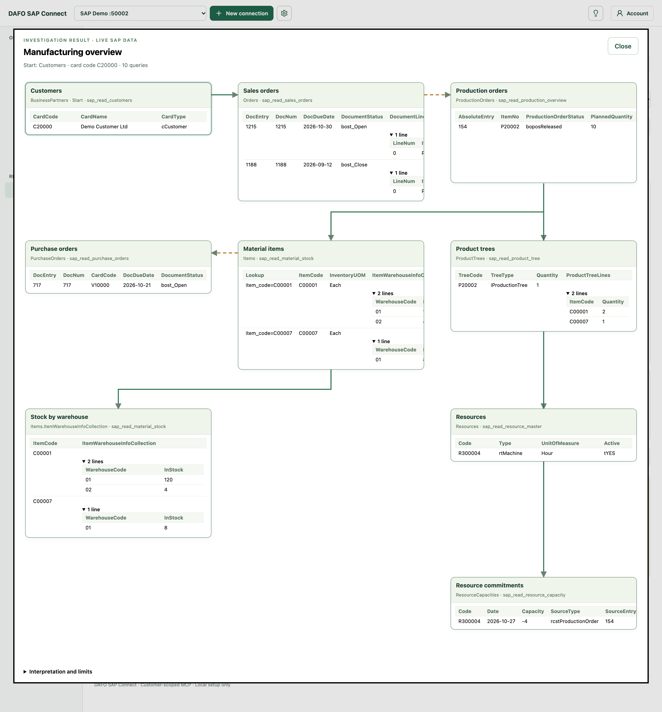
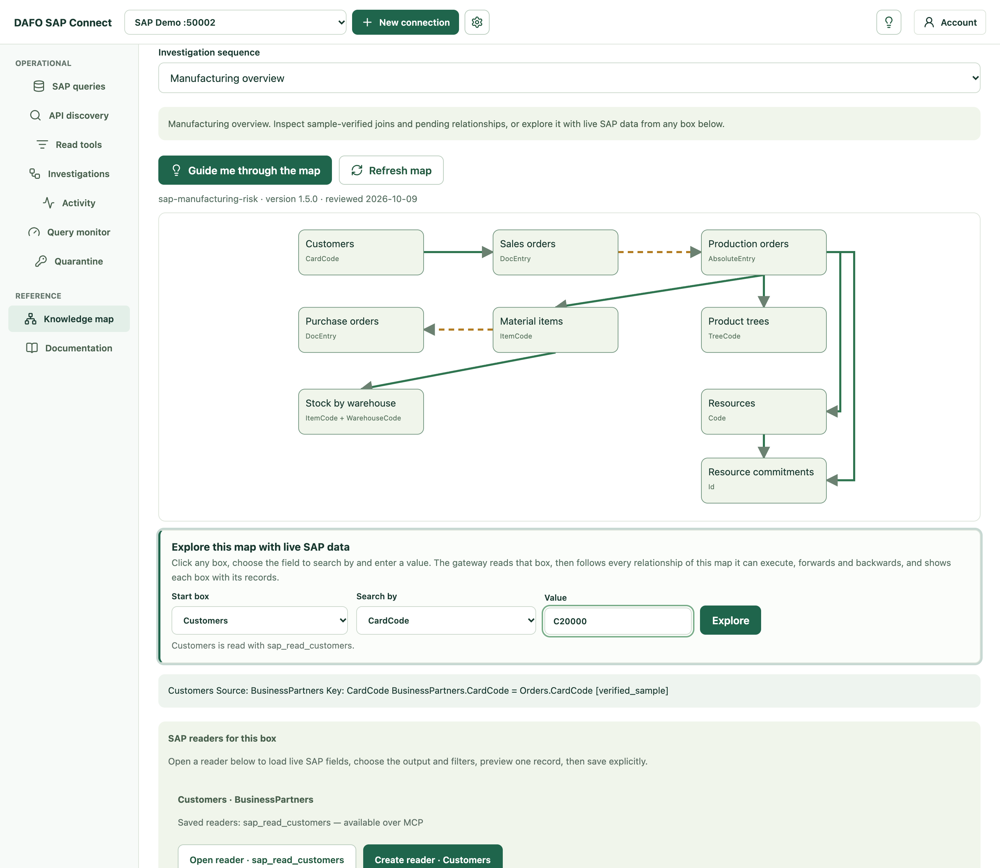
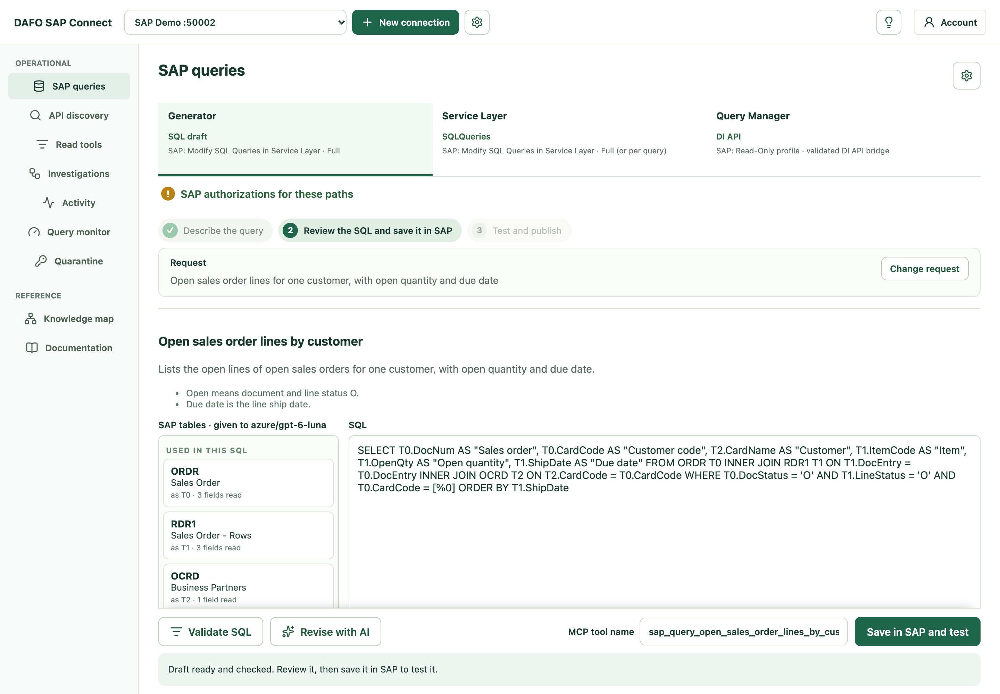
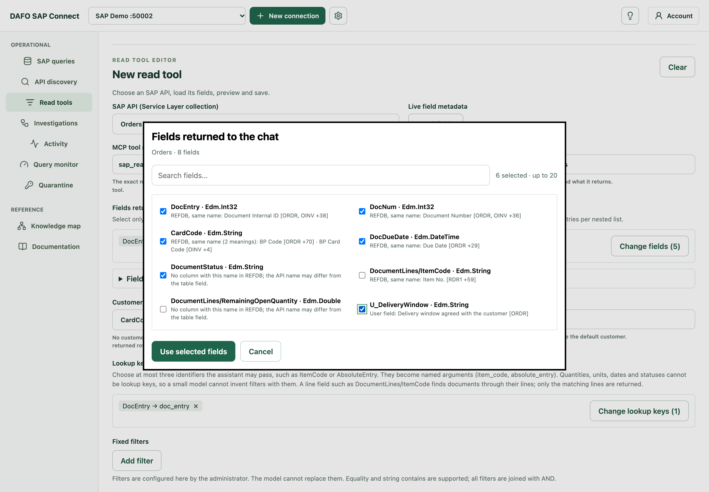

# DAFO SAP Connect

**Connect SAP Business One to your AI assistant — read-only, local and under the administrator's control.**

DAFO SAP Connect is a gateway that runs on a computer in your network and gives AI chat clients such as **DAFO Swarm** access to SAP Business One data through the [Model Context Protocol (MCP)](https://modelcontextprotocol.io). The assistant can only call the tools an administrator has created and switched on; SAP applies the integration user's own authorizations on every call.



## What it does

| Area | What you get |
|---|---|
| **Read tools** | Turn any SAP Service Layer collection (orders, items, production orders, business partners…) into an MCP tool. Choose the fields returned to the chat, the lookup keys the assistant may pass, fixed filters and customer scope. Every tool can be edited, disabled or classified — there are no hidden, hard-coded data tools. |
| **SAP queries** | Publish saved queries as MCP tools: draft new SQL with the AI **Generator** (checked against the SAP database reference before anything is saved), reuse **Service Layer** SQLQueries, or run **Query Manager** queries exactly as saved through the optional DI API bridge. Queries can run online or on a schedule, served from a local snapshot. |
| **Knowledge map** | A curated map of how SAP manufacturing data connects (customers, sales, production, materials, stock, purchases, resources, capacity), with the evidence for each relationship. Explore it with live SAP data from any box. |
| **Investigations** | Multi-step `investigate_*` tools that run a fixed sequence of reads, so a small model cannot skip a step. |
| **Access and audit** | Named access tokens, an activity log, a query monitor with timings, and quarantine for queries that must stop. |
| **Multiple SAP connections** | One management page for several SAP companies, each on its own MCP port. |

### Security by design

- Listens only on `127.0.0.1` — nothing is exposed to the internet or the LAN.
- MCP tools only read SAP data. SAP query definitions are written to SAP only when the administrator saves them in setup.
- The SAP server certificate is pinned during setup. Access tokens are kept in the macOS Keychain or Windows DPAPI; on Windows the SAP password is also DPAPI-encrypted.
- The administrator signs in to the setup page; MCP clients use their own named, revocable tokens.

## What's new in 0.1.0-20261015.5

### Explore the knowledge map from any box

Click any box of the map — a customer, a sales order, a production order, an item — choose the field to search by and enter a value. The gateway reads that box and follows every relationship it can execute, **forwards and backwards**. Each box opens in its own window, placed and connected exactly like the map, with the records SAP returned and expandable line details. Relationships not yet validated on real data are drawn dashed. If a box has no data, its window says why: no read tool, nothing to follow, a failed read or no executable relationship.



### A clearer SAP query Generator

The Generator now works in three steps — **Describe the query**, **Review the SQL and save it in SAP**, **Test and publish**. Progress, checks and SAP messages appear next to the buttons you just used, the action bar stays visible while you scroll, and the SQL is not shown twice after saving.



### Field meanings for the assistant

When choosing the fields of a read tool, each field shows its meaning from the SAP database reference (REFDB) or the SAP user-field definition. Administrators can confirm or write their own meanings; the assistant receives them through `describe_sap_tool_fields`.



### Also in this release

- Every data tool is an administrator-managed read tool; investigations are published only when all their read tools exist.
- SAP authorization guidance for integration users, including authorization groups and data ownership, and a clear *Read permitted · 0 rows* result when SAP hides records from the user.

*Screenshots use sample data.*

## Download

Get the installers from the [latest release](https://github.com/gabgiani/dafo-sap-connect-downloads/releases/latest).

| Platform | Installer | Requirements |
|---|---|---|
| macOS (Apple silicon) | `dafo-sap-connect-<version>-macos-arm64.pkg` — signed and notarized by Apple | macOS 26.5 or later |
| Windows (x64) | `dafo-sap-connect-<version>-windows-x64.exe` — signed by DAFO AI LTD | Windows 10 or later, administrator rights to install |

Both need network access to the SAP Business One **Service Layer** (`/b1s/v1/` or `/b1s/v2/`) and a dedicated SAP integration user. The macOS menu bar app checks for updates automatically. Each installer has a `.sha256` file next to it:

```sh
shasum -a 256 -c dafo-sap-connect-<version>-macos-arm64.pkg.sha256
```

After installing, open the setup page at `http://127.0.0.1:50002/`, sign in as administrator, configure the SAP connection and create an access token for your chat client.

---

Source code, customer data and credentials are not published in this repository.
