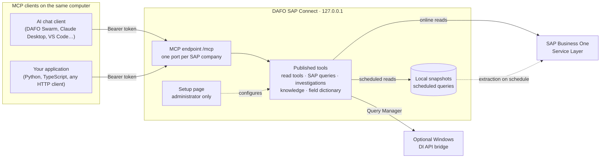

# DAFO SAP Connect

**Connect SAP Business One to AI assistants and applications through MCP — read-only, local and under the administrator's control.**

DAFO SAP Connect is a gateway that runs on a computer in your network. It publishes SAP Business One data as tools of a [Model Context Protocol (MCP)](https://modelcontextprotocol.io) server, so AI chat clients such as **DAFO Swarm**, desktop assistants and your own applications read SAP through one controlled interface. The AI can only call the tools an administrator has created and switched on; SAP applies the integration user's own authorizations on every call.


## How it fits together



## Documentation

Start with **How it works**, then follow the guide for your role.

| Guide | For | What it covers |
|---|---|---|
| [How it works](docs/concepts.md) | Everyone | Architecture, the tool families, connections and ports, access modes, what is published to the AI and the limits. |
| [Connect an AI client](docs/connect-ai-client.md) | Administrators | Access tokens, MCP URL, DAFO Swarm, Claude Desktop, VS Code and other MCP clients, which tools to enable, troubleshooting. |
| [Use the MCP server from an application](docs/connect-from-an-app.md) | Developers | The protocol on the wire, `curl`, Python and TypeScript examples, reading results, errors, pagination and integration patterns. |
| [Tool reference](docs/tool-reference.md) | Developers, administrators | Every tool family: arguments, result fields, limits and examples. |
| [Online or scheduled queries](docs/online-vs-scheduled.md) | SAP specialists | When a query must run live in SAP and when it should be extracted on a schedule and served from a local snapshot; parameter roles and filters. |
| [Organizing SAP information for the AI](docs/sap-specialist-guide.md) | SAP specialists | Topics, read tools, lookup keys, relationships and investigations; why the AI is not given every endpoint and how it never skips a related read. |
| [How the AI understands SAP data](docs/how-the-ai-understands-data.md) | SAP specialists, developers | Knowledge cards, interpretation rules, the field dictionary and how the AI learns what each query and column means. |
| [What's new](docs/whats-new.md) | Everyone | Highlights of the latest release. |

### For AI coding assistants

[`llms-full.txt`](llms-full.txt) is a single, self-contained file for AI coding assistants (GitHub Copilot, Claude Code, Cursor, Context7…): what the product enables, how to connect, rules, recipes in Python, TypeScript and curl, request and response shapes, errors, limits, and how to use it together with DAFO Swarm. Point your assistant at it when building an application that uses DAFO SAP Connect:

```text
https://raw.githubusercontent.com/gabgiani/dafo-sap-connect-downloads/main/llms-full.txt
```

[`llms.txt`](llms.txt) is the short index in the [llmstxt.org](https://llmstxt.org) format, and [`context7.json`](context7.json) configures indexing in Context7.

## Three ways to read SAP

| Way | MCP tools | Reads from | Best for |
|---|---|---|---|
| **API read tools** | `sap_read_*` | Service Layer collections (orders, items, production orders, business partners…), live on every call | Looking up records by an identifier: an order, an item, a customer |
| **SAP queries** | `sap_query_*` | Saved SQL (Generator, Service Layer SQLQueries or Query Manager), **online** in SAP or **scheduled** into a local snapshot | Joins, lists and history that a single collection cannot answer |
| **Investigations** | `investigate_*` | A fixed sequence of read tools run by the gateway, step by step | Questions that always need several related reads, such as *can this production order be built?* |

Support tools — `search_sap_knowledge`, `get_sap_knowledge`, `describe_sap_tool_fields` and `list_sap_queries` — give the AI guidance and field meanings without reading business records.

## Security by design

- Listens only on `127.0.0.1` — nothing is exposed to the internet or the LAN.
- MCP tools only read SAP data. SAP query definitions are written to SAP only when the administrator saves them in setup.
- The SAP server certificate is pinned during setup. Access tokens are kept in the macOS Keychain or Windows DPAPI; on Windows the SAP password is also DPAPI-encrypted.
- The administrator signs in to the setup page; MCP clients use their own named, revocable tokens, and every call is recorded in the activity log without its arguments.

## Download

Get the installers from the [latest release](https://github.com/gabgiani/dafo-sap-connect-downloads/releases/latest).

| Platform | Installer | Requirements |
|---|---|---|
| macOS (Apple silicon) | `dafo-sap-connect-<version>-macos-arm64.pkg` — signed and notarized by Apple | macOS 26.5 or later |
| Windows (x64) | `dafo-sap-connect-<version>-windows-x64.exe` — signed by DAFO AI LTD | Windows 10 or later, administrator rights to install |

Both need network access to the SAP Business One **Service Layer** (`/b1s/v1/` or `/b1s/v2/`) and a dedicated SAP integration user. The macOS menu bar app checks for updates automatically. Each installer has a `.sha256` file next to it:

```sh
shasum -a 256 -c dafo-sap-connect-<version>-macos-arm64.pkg.sha256
```

After installing, open the setup page at `http://127.0.0.1:50002/`, sign in as administrator, configure the SAP connection and create an access token for your chat client — see [Connect an AI client](docs/connect-ai-client.md).

---

Source code, customer data and credentials are not published in this repository.
