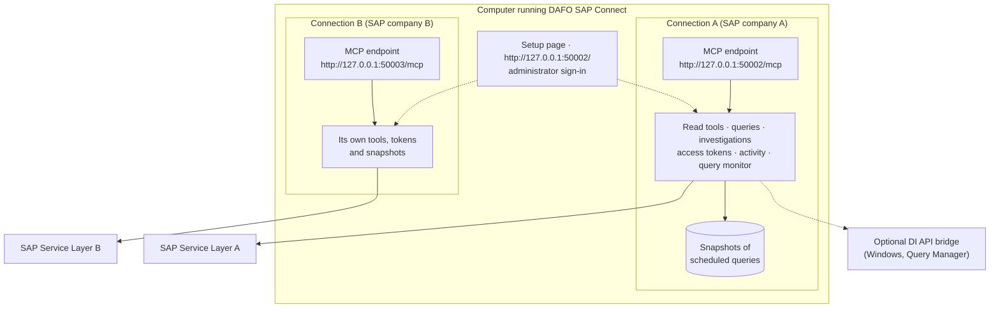
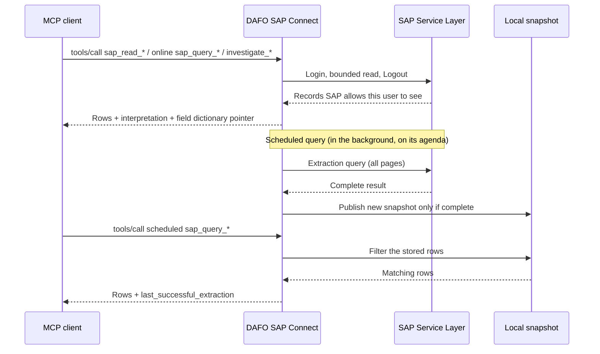

# How DAFO SAP Connect works

[← Documentation index](../README.md#documentation)

DAFO SAP Connect sits between SAP Business One and the AI. The administrator decides which SAP information can be read and how; the AI and applications only see the result of those decisions, as MCP tools.

## Components

| Part | Role |
|---|---|
| **Setup page** | The administrator's workspace on `http://127.0.0.1:50002/`: SAP connection, API discovery, read tools, SAP queries, knowledge map, investigations, access tokens, activity, query monitor and quarantine. |
| **Connection** | One SAP company (Service Layer URL, company database, integration user, pinned certificate). Each connection has its own tools, access tokens, activity log and snapshots. |
| **MCP endpoint** | `http://127.0.0.1:<port>/mcp` of a connection. The first connection uses port `50002`; every additional connection has its own port, shown in its connection settings. |
| **Service Layer** | SAP's REST API. Every online read goes there with the integration user's session, so SAP's own authorizations and data ownership rules apply. |
| **DI API bridge** | Optional Windows service that runs Query Manager queries exactly as saved in SAP. Its tools are published only after **Test DI API** succeeds in setup. |
| **Local snapshots** | A private SQLite database per connection that stores the result of each **scheduled** query. The AI reads it instead of SAP. |

## The tool families

The catalogue the AI receives is **dynamic**: it contains only what this connection's administrator has configured, enabled and published. There are no hard-coded SAP data tools.

| Family | Purpose | Reads SAP? |
|---|---|---|
| `sap_read_*` | **API read tools.** One Service Layer collection, with the fields, lookup keys, fixed filters and customer scope chosen by the administrator. | Yes, online |
| `sap_query_*` | **SAP queries.** A saved SQL query with declared parameters. Online queries run in SAP; scheduled queries read the latest local snapshot. | Online: yes. Scheduled: no |
| `investigate_*` | **Investigations.** A fixed sequence of read tools that the gateway runs in order from one identifier, following the relationships between SAP records. | Yes, online |
| `search_sap_knowledge`, `get_sap_knowledge` | Short, versioned guidance cards: which tool to use, exact joins, what can and cannot be concluded. | No |
| `describe_sap_tool_fields` | The meaning, type, allowed values and source table of the fields or columns a data tool returns. | No |
| `list_sap_queries` | The published SAP queries with their parameters and execution mode. | No |

All tools are annotated as read-only. Details for each family are in the [tool reference](tool-reference.md).

## What gets published to the AI

A tool appears in `tools/list` only when every rule below allows it:

| Rule | Effect |
|---|---|
| The tool is **enabled** | Disabled read tools and queries disappear immediately and their calls are rejected. |
| **Access mode** allows it | See the next section. |
| **Investigation selection** | If the administrator selected investigations (Setup → **Investigations** → **Save selection**), only the read tools those investigations need are published. **Publish all enabled readers** removes the restriction. |
| **Investigation readiness** | An `investigate_*` tool is published only when every read tool its path can run is itself published. |
| **DI API validation** | Query Manager tools that run through the Windows bridge are published only after **Test DI API** succeeds. |

Changes take effect on the next `tools/list`; MCP clients must refresh their tool list after the administrator changes the configuration.

## Access modes

Each connection runs in one of two modes, set in its connection settings.

| | Internal mode | Fixed-customer mode |
|---|---|---|
| Intended for | Your own staff | A single customer's view |
| Read tools with a customer field | Accept an optional `customer_code`; omitted means the configured default customer | Always use the configured customer; `customer_code` is rejected |
| Read tools without a customer field | Published | Hidden and rejected |
| SAP queries | Published | Only queries with a customer scope declared by the administrator; the server applies the configured customer and checks every returned row |
| `list_sap_queries` | Published | Hidden and rejected |
| Investigations | Published when ready | Published only if all their read tools have customer scope |

Neither mode is a guest login: an access token identifies a client application, not a customer user.

## Connections, ports and tokens

- All connections are administered from the single setup page on port `50002`.
- Each connection serves MCP on its own port; opening the root of that port redirects to its settings.
- Access tokens belong to one connection. A token of connection A is rejected on connection B's port.
- Requests must use the host `127.0.0.1:<port>` or `localhost:<port>`. Requests that carry a browser `Origin` header are rejected, so web pages cannot call the MCP endpoint directly.

## Online reads and snapshots

A scheduled query never falls back to SAP: if no complete snapshot exists, the tool answers *Query not available*. See [Online or scheduled queries](online-vs-scheduled.md).

## Limits

| Item | Limit |
|---|---|
| Read tool definitions | 30 per connection; 1–20 returned fields each, one nested line level, up to 3 lookup keys and 8 fixed filters |
| Read tool page | `top` 1–50 records (default 5); up to 50 entries per nested line list |
| SAP query definitions | 30 per connection |
| Query page | `top` 1–20 rows (default 5) |
| Service Layer query with `all_pages` / scheduled extraction | 16 MiB, 1,000 pages and 90 seconds; a partial extraction is never published |
| DI API query | First page only, up to 20 rows |
| Investigation | Up to 10 lookups per step; further lines are reported as skipped |
| MCP result | 64 KiB per call (16 MiB for `all_pages`) |
| Incoming SAP response for a read tool | 1 MiB |

A page, a sample or a missing continuation link is never proof that SAP has no further records. Every limit that cuts a result is reported in the result itself (`has_more`, `next_skip`, `complete`, `truncation_reason`, `nested_truncations`, `skipped`).

## What the gateway never does

- Expose write, update or delete operations on SAP business documents.
- Accept SQL, OData filters or collection names from the AI. The AI can only fill the declared arguments.
- Fall back from a scheduled snapshot to a live SAP query, or from one backend to another.
- Store the arguments of MCP calls or returned rows in the activity log or the query monitor.
- Treat a failed read as "no records": failures are returned as unavailable evidence.
