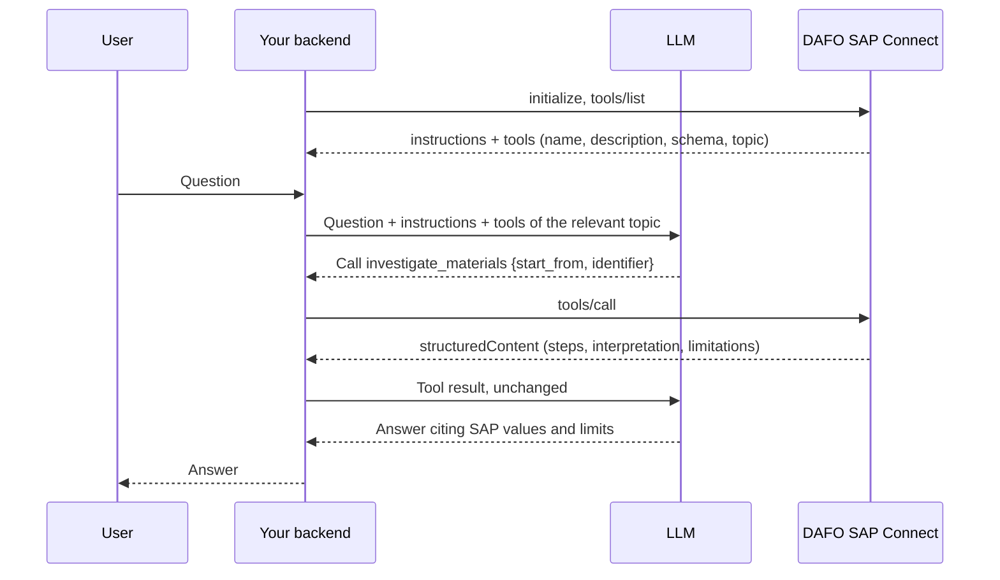

# Use the MCP server from an application

[← Documentation index](../README.md#documentation)

Applications use the same MCP endpoint, tokens and tools as AI clients. You can drive it with an official MCP SDK or with plain HTTP; no SAP credentials, OData or SQL are needed in your code.

If you build the application with an AI coding assistant, point it at [`llms-full.txt`](../llms-full.txt): the same integration contract in one file written for assistants.

Typical uses:

- **An application with its own LLM** — your backend lists the tools, offers them to the model as functions and executes the model's calls through MCP.
- **An application without an LLM** — a dashboard, a scheduled report or an integration calls specific tools with known arguments, for example an investigation for a production order or a scheduled query filtered by customer.

> The application must run on the same computer as DAFO SAP Connect and call it from server-side code. Requests with a browser `Origin` header are rejected, so a web front end must go through your own backend.

## The protocol on the wire

| Item | Value |
|---|---|
| Endpoint | `POST http://127.0.0.1:<port>/mcp` |
| Message format | [JSON-RPC 2.0](https://www.jsonrpc.org/specification), MCP methods `initialize`, `tools/list`, `tools/call` |
| Headers | `Authorization: Bearer <token>`, `Content-Type: application/json`, `Accept: application/json, text/event-stream` |
| Response | `application/json` with the JSON-RPC response |
| Sessions | Stateless: no `Mcp-Session-Id` is needed and every request stands alone. `initialize` is optional but returns the server's usage instructions. |
| Request body | Up to 2 MiB |

Create a dedicated token for the application under the connection's **Access tokens** (see [Connect an AI client](connect-ai-client.md#1-create-an-access-token)) and keep it outside the source code.

## Quick test with curl

Read the token without leaving it in the shell history:

```sh
read -rs SAP_CONNECT_API_KEY && export SAP_CONNECT_API_KEY
export SAP_CONNECT_URL=http://127.0.0.1:50002/mcp
rpc() {
  curl -s "$SAP_CONNECT_URL" \
    -H "Authorization: Bearer $SAP_CONNECT_API_KEY" \
    -H "Content-Type: application/json" \
    -H "Accept: application/json, text/event-stream" \
    -d "$1"
}
```

Server information and usage instructions:

```sh
rpc '{"jsonrpc":"2.0","id":1,"method":"initialize","params":{"protocolVersion":"2025-06-18","capabilities":{},"clientInfo":{"name":"curl","version":"1"}}}'
```

The tools this token can use, with their argument schemas:

```sh
rpc '{"jsonrpc":"2.0","id":2,"method":"tools/list","params":{}}'
```

Call a read tool:

```sh
rpc '{"jsonrpc":"2.0","id":3,"method":"tools/call","params":{"name":"sap_read_sales_orders","arguments":{"doc_entry":"1215","top":1}}}'
```

Run an investigation:

```sh
rpc '{"jsonrpc":"2.0","id":4,"method":"tools/call","params":{"name":"investigate_materials","arguments":{"start_from":"absolute_entry","identifier":"154"}}}'
```

Tool names and lookup arguments depend on the read tools configured in your installation; always take them from `tools/list`.

## Python (official MCP SDK)

```sh
pip install mcp
```

```python
import asyncio
import os

from mcp import ClientSession
from mcp.client.streamable_http import streamablehttp_client

URL = os.environ.get("SAP_CONNECT_URL", "http://127.0.0.1:50002/mcp")
HEADERS = {"Authorization": f"Bearer {os.environ['SAP_CONNECT_API_KEY']}"}


async def main() -> None:
    async with streamablehttp_client(URL, headers=HEADERS) as (read, write, _):
        async with ClientSession(read, write) as session:
            info = await session.initialize()
            print(info.instructions)

            listed = await session.list_tools()
            for tool in listed.tools:
                print(tool.name, "-", tool.description)

            result = await session.call_tool(
                "investigate_materials",
                {"start_from": "absolute_entry", "identifier": "154"},
            )
            if result.isError:
                # Unavailable evidence: report it, do not treat it as "no records".
                print("Not available:", result.content[0].text)
                return
            data = result.structuredContent
            for step in data["steps"]:
                status = "error" if "error" in step else "skipped" if "skipped" in step else "ok"
                print(step["step"], step["reader"], step.get("arguments"), status)


asyncio.run(main())
```

## TypeScript (official MCP SDK)

```sh
npm install @modelcontextprotocol/sdk
```

```ts
import { Client } from "@modelcontextprotocol/sdk/client/index.js";
import { StreamableHTTPClientTransport } from "@modelcontextprotocol/sdk/client/streamableHttp.js";

const transport = new StreamableHTTPClientTransport(new URL(process.env.SAP_CONNECT_URL ?? "http://127.0.0.1:50002/mcp"), {
  requestInit: { headers: { Authorization: `Bearer ${process.env.SAP_CONNECT_API_KEY}` } },
});
const client = new Client({ name: "my-sap-app", version: "1.0.0" });
await client.connect(transport);

const { tools } = await client.listTools();
console.log(tools.map((tool) => tool.name));

const result = await client.callTool({
  name: "sap_read_sales_orders",
  arguments: { card_code: "C20000", top: 5 },
});
if (result.isError) {
  console.error("Not available:", result.content);
} else {
  console.log(result.structuredContent);
}
await client.close();
```

## Reading a result

A successful `tools/call` returns:

```json
{
  "jsonrpc": "2.0",
  "id": 3,
  "result": {
    "content": [{ "type": "text", "text": "{\"tool\":\"sap_read_sales_orders\",\"rows\":[…],…}" }],
    "structuredContent": { "tool": "sap_read_sales_orders", "rows": [ … ], "has_more": false, … },
    "isError": false,
    "_meta": {
      "com.dafonet/result-classification": { "version": 1, "dataPaths": ["/rows"] }
    }
  }
}
```

| Field | Use |
|---|---|
| `structuredContent` | The result object. Read it directly; the text block is the same JSON, kept for clients that only show text. Do not parse both. |
| `isError` | `true` when the tool ran but nothing usable came back (SAP unreachable, sign-in failed, query not available). The text explains it. |
| `_meta["com.dafonet/result-classification"].dataPaths` | [JSON Pointers](https://www.rfc-editor.org/rfc/rfc6901) to the business records in this result, for example `/rows` or `/steps/0/result/rows`. Everything else is metadata: coverage, notes, interpretation rules. Empty for support tools and errors. |
| `column_dictionary` | Pointer to the field dictionary of this result; see [How the AI understands SAP data](how-the-ai-understands-data.md#the-field-dictionary). |

In `tools/list`, each tool carries `_meta["com.dafonet/tool-classification"]`:

```json
{ "version": 1, "purpose": "data", "category": { "id": "inventory", "label": "Inventory" } }
```

`purpose` is `data` (returns SAP business records) or `internal` (guidance and support). `category` is the topic chosen by the administrator — Inventory, Purchasing, Sales, Production, Resources, Support or a custom one. Use it to group tools by topic or to offer the model only the tools of one topic. A tool the administrator has not classified yet carries `"com.dafonet/classification-status": {"state": "unclassified"}` instead; it is still callable.

## Errors

| Where | Example | What to do |
|---|---|---|
| HTTP status | `401` token, `403` host or `Origin`, `404` wrong port, `413` request too large | Fix the configuration; see [troubleshooting](connect-ai-client.md#troubleshooting). |
| JSON-RPC `error` (code `-32602`, invalid params) | `Unsupported argument warehouse. sap_read_material_stock accepts only item_code, top, skip. Remove other arguments and retry; do not repeat the same call.` | The arguments do not match the schema. Correct them as the message says. |
| JSON-RPC `error` (internal) | `SAP result too large; reduce top` | Ask for a smaller page. |
| Result with `isError: true` | `SAP is not reachable right now (connection, VPN or the SAP server is off). Nothing was read…` | Unavailable evidence. Do not retry other SAP tools in a loop and do not report the data as missing. |

Messages are written for both people and models: they say what was not done and what to change. Never repeat an identical failing call.

## Pagination

Results report whether more data exists. Continue with the same arguments plus the offset the result gives you.

| Tool | Page size | Continue with | Notes |
|---|---|---|---|
| `sap_read_*` | `top` 1–50 (default 5); SAP may return fewer per page | `skip = next_skip` while `has_more` is `true` | Lookups on line fields return one bounded page; `skip` is not available for them. To check a full load, compare the loaded rows with `total_count` from the first page and look for duplicates by `record_key`. |
| Online `sap_query_*` (Service Layer) | `top` 1–20 (default 5) | `skip = next_skip`, or `all_pages: true` | Check `complete` and `truncation_reason`: `all_pages` stops at 16 MiB, 1,000 pages or 90 seconds and can be resumed. |
| `sap_query_*` through the DI API bridge | First page, up to 20 rows | — | `skip` and `all_pages` are not supported. |
| Scheduled `sap_query_*` | `top` 1–20, or `all_pages: true` | `skip = next_skip` **and** `snapshot_version` from the first page | If a new snapshot replaced the old one, the call fails with `snapshot_changed`: restart from `skip` 0. |

```python
async def read_scheduled(session, tool, filters):
    rows, skip, version = [], 0, None
    while True:
        args = {"parameters": filters, "top": 20, "skip": skip}
        if version:
            args["snapshot_version"] = version
        result = await session.call_tool(tool, args)
        if result.isError:
            raise RuntimeError(result.content[0].text)
        page = result.structuredContent
        rows += page["rows"]
        version = page["snapshot_version"]
        if not page["has_more"]:
            return rows, page["last_successful_extraction"]
        skip = page["next_skip"]
```

## Integration patterns

### Your application orchestrates an LLM



- Put the `instructions` returned by `initialize` in the system prompt.
- Offer only the tools of the topic in question (use `category`), plus the support tools.
- Pass tool schemas unchanged: they contain enums, required fields and `additionalProperties: false`.
- Return results to the model unchanged, including `interpretation`, `limitations`, `coverage` and `empty_result`; they tell the model what it may and may not conclude.

### Your application calls tools directly

- Prefer an `investigate_*` tool over chaining read tools yourself: the gateway resolves the relationships, deduplicates lookups and reports failed or skipped steps.
- For lists and reports, publish a **scheduled** query and show `last_successful_extraction` next to the data.
- Use `dataPaths` to extract the business records and keep the rest as context.
- Cache `describe_sap_tool_fields` results by `column_dictionary.id`; request it again only when the id changes.

### Good practice

- One named token per application, so its calls are identifiable and revocable.
- Respect `has_more`, `complete` and `coverage`; never present a page as the full picture.
- Treat `isError` and step `error`/`skipped` as missing evidence, not as zero.
- Refresh `tools/list` when the administrator changes the configuration; a disabled tool is rejected even if your client still lists it.
