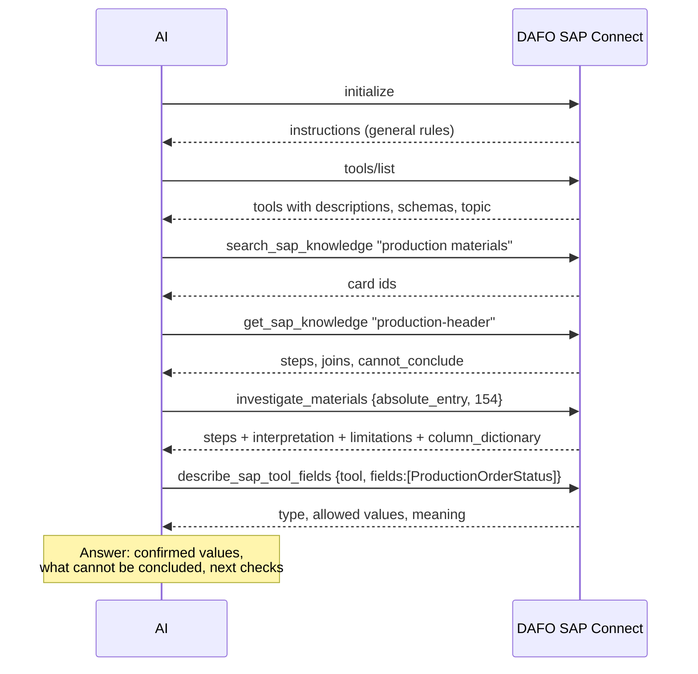
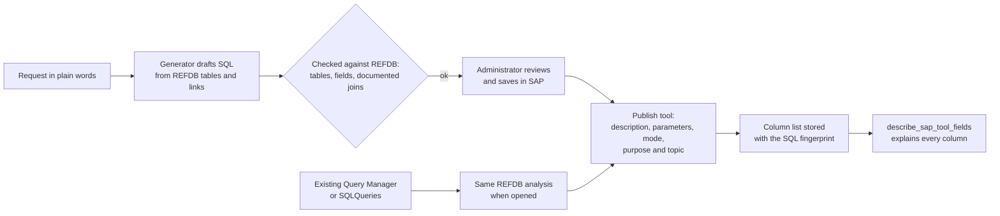

# How the AI understands SAP data

[← Documentation index](../README.md#documentation)

A model does not know your SAP company. It does not know that `bost_Open` means an open document, that *Committed* stock may already include the production order it is asking about, or that a column called `Line_TargetType` holds `15` when the line was delivered. DAFO SAP Connect gives the AI that knowledge in layers, each delivered at the moment it is useful, so the prompt stays small and the AI never needs to see SQL or the whole data model.

## The layers

| Layer | Delivered | Content | Maintained by |
|---|---|---|---|
| **Server instructions** | Once, in the `initialize` response | General rules: read only through the published tools, never invent SAP data, a failure is not absence, how to use knowledge and the field dictionary | The gateway |
| **Tool descriptions and schemas** | In `tools/list` | What each tool reads, its lookup keys, customer scope and execution mode; exact argument names, types and enums | Administrator (description) and gateway (the rest) |
| **Knowledge cards** | On demand: `search_sap_knowledge`, `get_sap_knowledge` | Which tool to use for a question, exact joins, steps, what cannot be concluded, evidence status | Knowledge package |
| **Interpretation in results** | With every read and investigation result | The rules of the card for that tool, the investigation's limitations, coverage and `answer_with` | Knowledge package and gateway |
| **Field dictionary** | On demand: `describe_sap_tool_fields` | For each returned field or column: source table and field, type, documented description, allowed values, join type | SAP metadata, SAP database reference (REFDB), administrator's field meanings |
| **Notes and errors** | In results | Coverage, truncation, empty lookups and failures, written so the model knows what to do next | The gateway |



Knowledge and the field dictionary are optional calls. Rules that must never be skipped are not left to the model's initiative: they are attached to the data itself.

## Server instructions

Every MCP client receives them when it connects. They tell the model, among other things, to:

- read SAP only through the tools configured for this connection and never invent SAP data;
- treat an empty result as *not found by this lookup*, not as proof that SAP has no records, and a failed call as unavailable evidence;
- not treat planned dates as delivery promises or *Ordered* stock as an identified purchase order or supplier;
- use `search_sap_knowledge` then `get_sap_knowledge` for guidance, loading only the needed card;
- call `describe_sap_tool_fields` to interpret a field, reusing a stored description while `column_dictionary.id` is unchanged;
- pass only the named lookup arguments, copy identifiers from the question or earlier results, and never repeat a failing call.

## Tool descriptions

Each description is built from the administrator's text plus facts the gateway adds:

| Tool | Description contains |
|---|---|
| `sap_read_*` | The administrator's description, the SAP collection, the lookup keys with their SAP fields (`item_code (ItemCode)`), and whether customer scope applies |
| `sap_query_*` | The administrator's description, the SAP query code, and how it runs: online with pagination rules, DI API first page, or *reads the scheduled snapshot only; never calls SAP* |
| `investigate_*` | The investigation title, what the path reads, the identifiers it can start from, and *prefer it over single readers for this question* |

The administrator's description is the most important text the model reads when choosing a tool. Write what the records are, what they are not and which identifier finds them:

| Weak | Strong |
|---|---|
| *Orders* | *Sales orders and their lines, by customer (card_code) or by order (doc_entry, doc_num). Not deliveries or invoices.* |
| *Stock query* | *Stock per warehouse of one item (item_code): InStock, Committed and Ordered. Committed may already include the production order being checked.* |

## Knowledge cards

The knowledge package (`sap-manufacturing-risk`, versioned) holds short cards for the manufacturing topics: production, materials and stock, resources and capacity, purchasing, sales, traceability, recipes and billing. A card contains:

| Field | Purpose |
|---|---|
| `question` | The question the card answers |
| `tool`, `arguments` | The read tool to use and an example call |
| `steps` | How to read and combine the results, in order |
| `cannot_conclude` | Conclusions the data does not support |
| `edges` → `relationships` | The exact joins, their meaning and whether they were verified |
| `evidence_status` | `verified_sample` (checked on real data), `partial`, `not_validated` or `planned` |

Example of the rules a card carries for warehouse stock:

```json
{
  "steps": [
    "Call with item_code only, copied from a pit_Item production line. Never add quantity, unit or warehouse arguments.",
    "Report only the warehouse entry whose WarehouseCode matches the production line Warehouse.",
    "Always report InStock, Committed and Ordered together.",
    "Compare with the line PlannedQuantity only after confirming compatible units."
  ],
  "cannot_conclude": [
    "Do not subtract the same production demand twice if already included in Committed.",
    "Aggregate commitments are not a reservation for a particular order.",
    "Ordered is not a confirmed arrival date."
  ]
}
```

Cards never grant permissions and never contain business data: they guide which published tool to call and how to read it. Relationships accepted on your installation (**Knowledge map** → check → **Accept**) are shown as *checked on this installation*.

## Interpretation travels with the data

A model may skip the knowledge tools. So every read tool result for which a card exists includes its rules in `interpretation`, and every investigation result includes:

- `interpretation` — the rules of every read tool it used;
- `limitations` — what the investigation cannot establish (for example, unit conversion not validated);
- `coverage` — every step ran, each bounded; failed or skipped steps are unavailable evidence;
- `answer_with` — use every step; separate confirmed values, possible risks, what cannot be concluded and the next checks.

Read results also carry `coverage: bounded_query`, `has_more`, `nested_truncations` and, when a lookup returns nothing, `empty_result`: *this proves only that this exact lookup found nothing; an item code is not a resource code, a document number is not an internal entry.*

## The field dictionary

Every data result contains a pointer:

```json
"column_dictionary": {"tool": "describe_sap_tool_fields", "id": "4f0c2a9d1e7b3c55"}
```

When the model needs to interpret a value, it calls `describe_sap_tool_fields` with the tool name and the fields. The answer is built only from sources this installation holds; it never contacts SAP and never guesses meaning from names. The `id` changes when the columns, the reference or the metadata change, so a client can store the description and reuse it.

### For read tools

| Source | Gives |
|---|---|
| SAP Service Layer metadata (captured in setup) | Each property's type and enumeration values, for example `ProductionOrderStatus`: `boposPlanned`, `boposReleased`, `boposClosed`, `boposCancelled` |
| SAP user-field definitions | Descriptions of `U_` fields |
| Administrator's **field meanings** | The business meaning of each field, written or confirmed in **Read tools → Field meanings for the assistant** |

The Service Layer metadata has no descriptions; without field meanings, API fields are reported as `not_documented`. Setup suggests meanings from REFDB columns with the same name, for review.

### For SAP queries

The AI never receives the SQL text. When the administrator saves a query tool, the gateway parses its SQL against the SAP database reference (REFDB, imported from the SAP Business One SDK) and stores a **column list**: for each result column, the table, alias, field and join type it comes from.

```json
{"column": "Line_TargetType",
 "provenance": {"kind": "table_field", "table": "RDR1", "table_alias": "T1", "field": "TargetType", "join": "inner"},
 "sap_type": "Int",
 "description": {"text": "Target Document Type", "source": "refdb"},
 "values": [["-1", ""], ["15", "Delivery"], ["13", "A/R Invoice"]]}
```

| Field | Meaning for the AI |
|---|---|
| `provenance.kind` | `table_field` (described), `expression` (calculated; not described), `wildcard` (`*`), `unknown` (alias not resolvable) |
| `join` | `left`, `right` or `full` joined tables can be null |
| `values` | Documented codes and their texts |
| `sql_pinned` | `true` when the gateway verifies the SQL in SAP is the one reviewed; otherwise the column list may be stale |
| `unmapped_columns` | Columns returned now that were not in the saved list (for example after `SELECT *` or an SQL change) |

The dictionary also states facts that come from structure: joins can repeat master data across lines (summing can double-count), and tables joined without a date show values at query time, not at document date. Units, currency and the point in time a value refers to are never documented unless a description says so.

## How queries get their documentation



The administrator's description and parameter descriptions tell the AI *when* to use the query; the column list and REFDB tell it *what each column means*. Both are needed: write the description for the question, and keep column names meaningful (`Warehouse_OnHand` rather than `Col5`).

## What you should write, and what the gateway handles

| You write | The gateway handles |
|---|---|
| Tool descriptions in plain English: what, what not, found by which identifier | Argument schemas, enums, required fields |
| Field meanings with units and time reference | Types, enumerations, REFDB descriptions, join provenance |
| Parameter descriptions for queries | Paging and freshness fields |
| Investigation title and question | Running every step and reporting failures |
| Accepting relationships checked on your data | Marking unvalidated relationships in every result |
