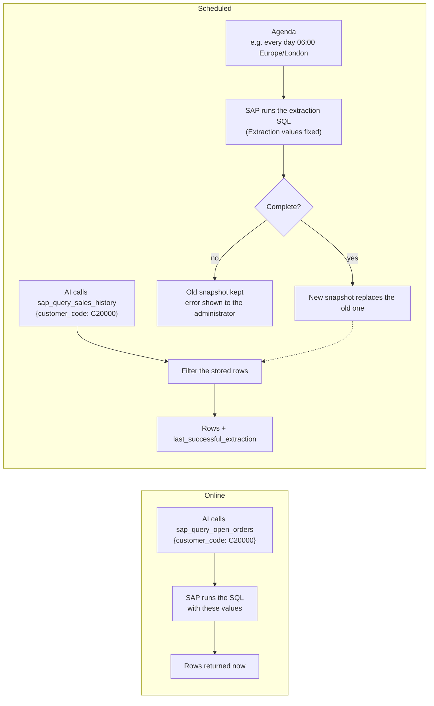
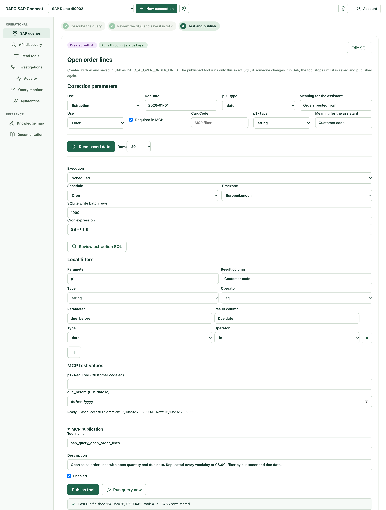

# Online or scheduled queries

[← Documentation index](../README.md#documentation)

Every published SAP query runs in one of two modes. Choosing well protects SAP from unnecessary load and gives the AI data with a clear freshness.

| | **Online** | **Scheduled (replicated)** |
|---|---|---|
| When SAP is queried | On every MCP call | On the agenda you define, in the background |
| What the AI reads | Live rows from SAP | The latest complete snapshot stored on the gateway computer |
| Arguments | All SQL parameters, required | Filters over the stored rows, required or optional |
| Freshness | Now | `last_successful_extraction`, returned with every answer |
| Load on SAP | One execution per question | One extraction per scheduled run, whatever the number of questions |
| If SAP is down | The call fails: *SAP is not reachable* | Answers keep coming from the last good snapshot |
| Backends | Service Layer SQLQueries, Query Manager through Service Layer or the DI API bridge | Service Layer SQLQueries and Query Manager through Service Layer |

Read tools (`sap_read_*`) and investigations (`investigate_*`) always read SAP online: they look up a few records by identifier and are cheap. The choice applies to SQL queries.

## How each mode runs

## Which mode to choose

Choose **online** when:

- The answer must reflect SAP *now*: open quantities, document status, stock before a decision.
- The query is narrow — it always receives an identifier or a short date range and returns few rows.
- Questions are occasional, so the load per question is acceptable.

Choose **scheduled** when:

- The query is heavy: many joins, long history, many rows.
- Many questions hit the same data: sales history, open items reports, price lists, KPIs.
- An answer *as of this morning* (or the last hour) is acceptable, and the AI can say so.
- SAP must be protected during working hours, or is not always reachable.

| Example question | Recommended |
|---|---|
| *What is the status of sales order 1215?* | Online read tool (`sap_read_sales_orders`) |
| *Can production order 154 be built?* | Investigation (`investigate_materials`), online |
| *Which order lines of customer C20000 are still open?* | Online query with `customer_code`, or scheduled every 15–60 minutes if asked often |
| *What did customer C20000 buy in the last two years, by item?* | Scheduled query, daily, filtered by customer |
| *Which items had no movement since January?* | Scheduled query, daily or weekly |

## Parameter roles in scheduled queries

When a query has an agenda, each SQL parameter gets a role in the query editor (**Use** column):

| Role | Meaning | Example |
|---|---|---|
| **Extraction** | A fixed value used when the data is collected. It needs a value for the agenda and is not offered to the AI. | `date_from = 2024-01-01` |
| **Filter** | Removed from the extraction so rows for **all** values are collected once; then offered to the AI as a filter over the stored rows. Not given a value at extraction time. | `customer_code` |

Each Filter has **Required in MCP** (checked by default). Unchecked, the AI may omit it and receives the stored rows for every value.

Because a Filter parameter is removed from the SQL, the gateway derives an **extraction SQL** and asks you to **review** it before publishing. The original query in SAP is never modified: publishing registers a separate technical copy for the extraction. Changing roles or types invalidates the review.

The derivation is exact, not guessed. It accepts conditions joined by `AND`: direct comparisons (`=`, `<>`, `<`, `<=`, `>`, `>=`, also written in reverse order) and positive `BETWEEN`. It rejects, with an explanation, Filter parameters used inside `OR` or `NOT`, aggregates and `GROUP BY`, `DISTINCT`, subqueries, CTEs, window functions, row limits and parameters used outside the `WHERE` clause. Use Extraction for those, or rewrite the query.

### Additional local filters

You can add further filters on any result column, independent of the SQL parameters:

| Types | Operators |
|---|---|
| text, number, date, yes/no | equals, not equals, greater than, greater or equal, less than, less or equal, contains (text) |

They let the AI ask narrow questions — *items with stock above 100*, *documents after 1 March* — without new SAP executions. Dates accept SAP's compact `YYYYMMDD` and ISO formats in the stored rows; the AI passes `YYYY-MM-DD`. Text comparison is exact and case-sensitive.

## The agenda

| Option | Example |
|---|---|
| Every N minutes or hours | Every 30 minutes |
| Selected days at a time | Monday to Friday at 06:00 |
| A specific date and time | Once on 1 November at 22:00 |
| Cron expression (5, 6 or 7 fields) | `0 */2 * * 1-5` |

Every agenda has an explicit IANA time zone (for example `Europe/London`). **Run query now** runs the extraction on demand once the tool is published and enabled; setup shows it running, then the time, duration and number of rows stored, or the error.

## Snapshot rules

- A new snapshot replaces the previous one **only when the extraction completes**. A partial result is never published.
- If a refresh fails, the last good snapshot stays available with its original extraction time. The failure is shown to the administrator in setup and the query monitor; the AI is not given SAP error details.
- Before the first complete extraction, or after the query definition changed, the tool answers *Query not available* and nothing else. There is no silent fallback to an online query.
- One extraction runs at a time across the gateway, with at most one pending run per query. Pending runs are not replayed after a restart; the next scheduled time applies.
- Readers paging through a snapshot pass `snapshot_version`; if a new snapshot replaced it meanwhile, they are told to restart, so pages from two extractions are never mixed.
- Snapshots are stored in a private SQLite database for each connection on the gateway computer.

## How the AI is told about freshness

The scheduled tool's description says it reads a stored snapshot and never calls SAP. Every answer carries `last_successful_extraction`, so the AI can say *according to the data extracted today at 06:00*. The extraction parameters used (for example the start date) are returned in `extraction_parameters`, so the AI knows the period the data covers.

## Protecting SAP

- **Query monitor** (setup) records every online execution, preview and scheduled extraction: source (SAP or local snapshot), duration and number of rows — never SQL text, arguments or row contents.
- **Quarantine** stops a query that must not run again: new MCP calls, previews and scheduled runs of that query (and any alias of the same SAP query) are blocked until released. It does not cancel a statement SAP is already executing.
- Extractions are bounded to 16 MiB, 1,000 pages and 90 seconds. Very large datasets need a narrower extraction (for example a later start date).
