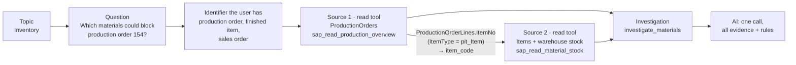
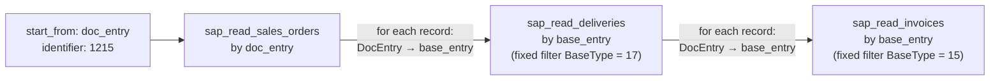
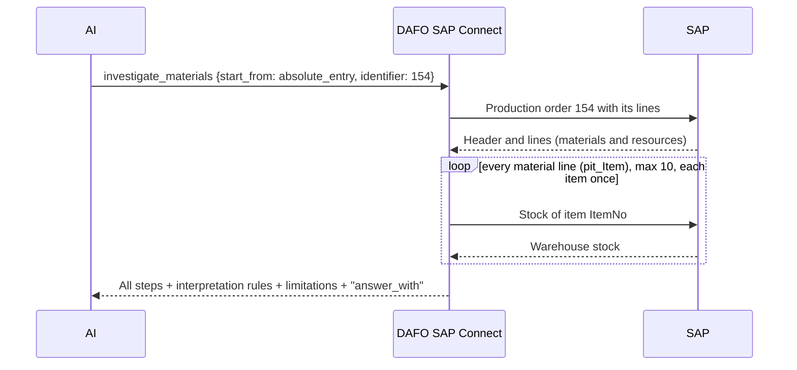

# Organizing SAP information for the AI

[← Documentation index](../README.md#documentation)

This guide is for the SAP Business One specialist who prepares DAFO SAP Connect for a company. Your job is not to expose SAP; it is to decide **which questions the AI must answer**, **which SAP information answers them** and **how that information is related**. The gateway then turns those decisions into a small set of tools that the AI cannot misuse.

## Why the AI is not given every endpoint

The Service Layer exposes hundreds of collections and actions. Publishing all of them as tools does not make the AI more capable; it makes it worse:

| If the AI gets every endpoint | What happens |
|---|---|
| Every tool's name, description and schema is sent to the model on every turn | Most of the context is spent on tools that are irrelevant to the question; smaller and local models lose track. |
| Many similar tools (Orders, Quotations, DeliveryNotes, Invoices…) | The model picks the wrong one, or invents filters and fields that do not exist. |
| Related information lives in different collections | The model reads the first record, answers, and **forgets** the related reads: the stock of each component, the receipts of each purchase order, the capacity of each resource. |
| Generic filters | The model writes conditions that are syntactically valid but semantically wrong, such as matching an item code against a resource code. |
| No business rules | The model concludes too much: *Ordered* stock becomes a confirmed arrival, an empty result becomes *there is none*. |

DAFO SAP Connect avoids this with a few deliberate design choices:

| Design choice | Effect on the AI |
|---|---|
| **Few, purpose-built read tools** — one per SAP source, with only the fields that answer questions | Small catalogue, predictable results |
| **Named lookup keys instead of free filters** — `item_code`, `doc_entry`, `base_entry` | The model can only copy identifiers; it cannot write queries |
| **Investigations run by the gateway** — `investigate_*` executes every related read in order from one identifier | The model cannot skip or forget a step |
| **Topic selection** — selecting investigations publishes only the read tools they need | Each chat sees one topic's tools, not the whole ERP |
| **Rules travel with the data** — every result carries interpretation rules, limitations and coverage | The model is told what it may and may not conclude at the moment it reads the data |
| **Documentation on demand** — knowledge cards and the field dictionary are separate tools | Guidance is fetched only when needed, instead of filling every prompt |

## The model: topics, questions, sources and relationships

| Building block | What you decide | Where in setup |
|---|---|---|
| **Topic** | A business area: Inventory, Purchasing, Sales, Production, Resources, or your own | Classification of each tool when publishing |
| **Read tool** (`sap_read_*`) | One SAP source: fields, lookup keys, fixed filters, customer scope, field meanings | **Read tools**, **Discover APIs**, or a template from the **Knowledge map** |
| **Relationship** | Which returned field of one source identifies records of another | **Knowledge map** (check and accept), investigation steps |
| **Investigation** (`investigate_*`) | The identifiers a question can start from and the reads that always follow | **Investigations** → **New investigation** or a package investigation |
| **SAP query** (`sap_query_*`) | SQL for lists, joins and history; online or scheduled | **SAP queries** |
| **Publication** | Which investigations — and therefore which read tools — each connection publishes | **Investigations** → **Review changes** → **Save selection** |

## Step by step

### 1. Write down the questions per topic

Start from what people will ask, not from SAP tables. For each topic, list the questions and **the identifier the user will have** when asking.

| Topic | Question | Identifier the user has |
|---|---|---|
| Production / Inventory | Can this production order be built? | Production order number, finished item |
| Sales | What happened to this sales order — produced, delivered, invoiced? | Sales order number, customer code |
| Purchasing | Is the material on order, and was it received? | Item code, purchase order number |

### 2. Map each question to SAP sources and relationships

For each question, list the SAP sources (Service Layer collections) and the field that leads from one to the next. Open the **Knowledge map**: it already describes the manufacturing sources (customers, sales orders, production orders, materials, warehouse stock, purchases, receipts, resources, capacity, deliveries, invoices, payments) and their joins, with the evidence for each.

### 3. Create one read tool per source

Start from the map's template when one exists (**Create it**), or from **Discover APIs** → **New read tool**. Then:

| Setting | Rule of thumb |
|---|---|
| **Name** | `sap_read_` + the business object, in plural: `sap_read_sales_orders`. This exact name is what the AI and the activity log see. |
| **Description** | What the records are and what they are not, in plain English. *Sales orders and their lines; not deliveries or invoices.* |
| **Fields** (1–20) | Only what answers the questions, **plus every field another source points to** (`DocEntry`, `ItemNo`, `BaseEntry`, `LineNum`). Without the join field, no relationship can be followed. One level of lines is supported, for example `DocumentLines/ItemCode`. |
| **Lookup keys** (up to 3) | The identifiers users have **and** the fields other sources use to find these records. Stock is found by `ItemCode` (→ `item_code`) because production lines carry `ItemNo`. Deliveries are found by `DocumentLines/BaseEntry` (→ `base_entry`) because they point to the sales order. |
| **Fixed filters** (up to 8) | Scope that must always apply. Example: deliveries found by `base_entry` should also filter `DocumentLines/BaseType = 17` so the entry always means a sales order. |
| **Customer scope** | The field that holds the customer (`CardCode`, `CustomerCode`), so fixed-customer connections can use the tool. |
| **Field meanings** | Under **Field meanings for the assistant**: write what codes and quantities mean, with units and the moment in time they refer to. **Fill empty meanings from REFDB** proposes descriptions from the SAP database reference; review them. |

Choose **Preview one record**, then **Save read tool**.

### 4. Check the relationships on real data

Click a link on the **Knowledge map**. It explains the relationship in plain words and offers a three-step check: the read tools it needs, an example identifier, and **Accept**. The check reads the source record, follows the declared field and looks for the linked records. If SAP confirms it, the link turns green as *checked on this installation*. Amber dashed links have not been confirmed; they can still run, but every result says so.

You can also **explore the map from any box**: choose a box, the field to search by and a value. The gateway reads that box and follows every relationship forwards and backwards, showing what each box returned — or why it returned nothing.

### 5. Turn the question into an investigation

An investigation is the question encoded as a fixed path:

| Part | Meaning | Example (`investigate_materials`) |
|---|---|---|
| **Entry points** | The identifiers the question can start from; each becomes a value of `start_from` | `absolute_entry` (production order), `item_no` (finished item, 3 latest orders), `sales_order_doc_entry` (orders whose origin is that sales order) |
| **First read** | The read tool and lookup each entry point uses | `sap_read_production_overview` by `absolute_entry`, `item_no` or `production_order_origin_entry` |
| **Follow-up reads** | For each record **or line** of an earlier step, read another tool with a returned field as its lookup; optionally only lines matching a value | For every `ProductionOrderLines` line with `ItemType = pit_Item`, read `sap_read_material_stock` with `item_code = ItemNo` |

The knowledge package includes four ready investigations (materials, traceability, capacity, procurement). For other questions use **Investigations** → **New investigation**: a starting read tool and the lookups the chat may start from, then up to four follow-up reads. You can also **Edit** or **Duplicate** a package investigation; **Restore original** removes your changes.

Example — *Sales order fulfilment* built in setup:

The AI then answers *what happened to sales order 1215?* with one call, and receives the order, every delivery based on it and every invoice based on those deliveries — or a clear `skipped`/`error` for each step that had nothing to follow or failed.

### 6. Classify the tools

When publishing a read tool, a query or an investigation, set:

- **Purpose** — *Data* (returns SAP business records) or *Internal* (support).
- **Topic** — Inventory, Purchasing, Sales, Production, Resources, Support, or a custom topic with its own id and label.

MCP clients receive this classification with each tool and can offer the model only the tools of one topic. Tools saved before classification existed can be classified with **Classify existing tools**.

### 7. Choose what each connection publishes

In **Investigations**, each investigation shows one status: *Ready in chat*, *Readers missing*, *Off in chat* or *Not runnable yet*. Select the investigations this connection should offer, choose **Review changes** to see which read tools will be added, kept or removed, and **Save selection**.

| After saving a selection | Effect |
|---|---|
| Read tools | Only those needed by the selected investigations are published; others stay saved but hidden |
| `search_sap_knowledge` | Stops returning cards of investigations that are not selected |
| `investigate_*` | Published only when all its read tools are published |
| **Publish all enabled readers** | Returns to publishing every enabled read tool |

Use separate connections (each with its own port and tokens) when different teams need different topics from the same SAP company.

### 8. Add SAP queries where read tools are not enough

Read tools look up records by identifier. For lists, aggregations, joins across many tables and history, create a query in **SAP queries**: write SQL with the **Generator** (it is checked against the SAP database reference before it is saved in SAP), reuse a Service Layer SQLQuery, or run a Query Manager query through the DI API bridge. Then decide whether it runs **online** or **scheduled** — see [Online or scheduled queries](online-vs-scheduled.md).

### 9. Test like the AI will

1. Explore the map from the box the question starts from.
2. Connect a chat client and ask the question in the users' words.
3. Check **Activity** (which tools were called) and the **Query monitor** (durations, rows, failures).
4. If the AI used the wrong tool, improve descriptions and field meanings, or narrow what is published — do not add more tools.

## How the AI never forgets a related read

1. **The sequence is executed by the gateway, not by the model.** The model chooses only the kind of identifier and its value. The gateway runs the first read, then every follow-up read for every matching record or line. A step cannot be skipped because the model never decides whether to run it.
2. **Every step is accounted for.** Each read appears in `steps` with its result, its `error`, or the reason it was `skipped` (nothing to follow, or more than ten lines). The model cannot mistake a missing step for an empty one.
3. **The rules come with the evidence.** The result includes the interpretation rules of each read tool (what to report, what cannot be concluded), the investigation's limitations and an `answer_with` instruction: use every step and separate confirmed values from what cannot be concluded.
4. **The catalogue stays small.** The model sees the investigations of its topic and their read tools, so the right tool is obvious.
5. **Single reads remain available** for follow-up questions about one record, with the same rules attached.

## Checklist

- [ ] Each topic has its questions and the identifiers users will have.
- [ ] Each SAP source has one read tool with a clear name and description.
- [ ] Every join field is selected as an output field in the source and as a lookup key in the target.
- [ ] Fixed filters encode scope that must always apply (document base type, item type, status).
- [ ] Codes, quantities and dates have field meanings, with units.
- [ ] Relationships used by investigations are checked and accepted on real data, or accepted as unvalidated knowingly.
- [ ] Each multi-step question has an investigation with the entry points users need.
- [ ] Tools are classified by purpose and topic.
- [ ] The connection publishes only the selected investigations.
- [ ] Heavy SQL is scheduled; live SQL is narrow.
- [ ] The questions were tested in a chat and the activity log shows the expected tools.
